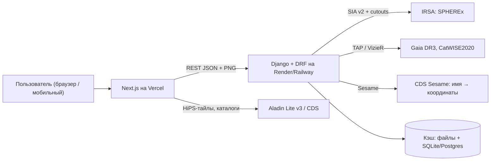

# План проекта SkyBlink: NASA Space Apps 2026, челлендж «Planet X and SPHEREx»

> **Редакция 3 — 14 ноября 2026.** Сначала прочитать `00_COMMON.md` §0: там проверенные живыми запросами факты и пересчитанный под дедлайн таймлайн. Этот документ описывает продукт и этапы. Техническая структура, роли, API и общие контракты определяются `00_COMMON.md`; персональные задачи участника #1 — `01_PLAN_Core_Viewer.md`. При расхождении приоритет у `00_COMMON.md`.

> **Для кого этот документ:** для ИИ-агента-исполнителя (Gemini 4 Hydrogen в Antigravity). Работай строго по фазам. После каждой фазы проверяй «критерии готовности» и только потом переходи к следующей. Если факт помечен ⚠️ ПРОВЕРИТЬ, сначала проверь его по официальным туториалам IRSA и только потом пиши код, который на нём держится.

---

## 0. Контекст и ограничения

| Параметр | Значение |
|---|---|
| Челлендж | https://www.spaceappschallenge.org/2026/challenges/planet-x-and-spherex/ |
| Задача | Публичный веб-инструмент. Пользователь вводит координаты (RA/Dec) или название объекта, а инструмент показывает серию снимков SPHEREx этого участка как анимацию (blink), чтобы было видно движущиеся и переменные объекты |
| Тестовые объекты | Barnard's Star, Epsilon Indi B, WISE 0855−0714 (RA 08h55m10.831s, Dec −07°14′42.53″), RW Aurigae, R Draconis — **прямо указаны в тексте челленджа** («Test your tool on…»). |
| Команда | 2–3 человека, вайбкодеры (пишут код через Antigravity). Опыта с астроданными нет, поэтому агент **объясняет астрономические решения в комментариях и README** |
| Время | ⏰ **Подача закрывается вс 15 ноября в 23:59 по местному времени** (проверено). От старта в сб 14:00 это ~34 часа. Внутренняя подача — **вс 21:30**. Таймлайн — `00_COMMON.md` §10. |
| Главная ценность | **Доступность**: инструментом должен легко пользоваться обычный человек без знания астрономии |
| Цель | Победа или выход на глобальный этап |
| Стек | Backend: **Django + Django REST Framework** (Python). Frontend: **Next.js (React, TypeScript)**. Небо: **Aladin Lite v3** |
| Хостинг | Frontend на **Vercel**, backend на **Render** или **Railway** |
| Языки UI | **en** (основной), **ru**, **uz**, с архитектурой под добавление других |
| Адаптивность | Обязательна (mobile + desktop) |
| Аккаунты | Опционально, только чтобы сохранять находки. Всё остальное работает без входа |
| ML | **Отложен** (решение команды) |

> [!IMPORTANT]
> Создавай проект в **отдельной папке `D:\skyblink\`**. Папка `D:\digital-lib` — другой, не связанный проект, её **не трогать**.

---

## 1. Что нужно знать о данных SPHEREx (прочитать до начала кода)

1. SPHEREx покрывает небо в диапазоне **0.75–5.0 мкм**. В приборе шесть детекторных массивов с линейно-переменными фильтрами (LVF); 102 канала относятся к All-Sky Cube, а не к числу отдельных кадров Level 2. Пиксель Spectral Image — **6.15″** (SIA2 `s_pixel_scale` и документация IRSA).
2. **Актуальные продукты на 14.11.2026:** для новых запросов использовать спектральные изображения **DR1 (`spherex_dr1`) и QR3 (`spherex_qr3`)**; при необходимости глубокого поля — соответствующие `_deep` коллекции. DR1 + QR3 заменяют QR2 для нового поиска. Не смешивать QR2 с DR1/QR3 в одном научном стеке без отдельной проверки калибровок.
3. **Два разных типа данных:**
   - Level 2 Spectral Image MEF — отдельные наблюдения/эпохи, основа временного blink.
   - DR1 All-Sky Cube (`spherex_dr1_cube`) — пространственно-спектральный куб на 102 канала, пригоден для спектрального обзора, но не заменяет временные кадры. Его пиксель около 12.9″, а не 6.15″.
4. **Level 2 MEF:** шесть HDU: `IMAGE`, `FLAGS`, `VARIANCE`, `ZODI`, `EPSF` (DR1/QR3; в QR2 было `PSF`), `WCS-WAVE`. `IMAGE` — поверхностная яркость в MJy/sr; `ZODI` — модель фона и не вычтена из `IMAGE`. Значения FLAGS декодировать по официальной таблице битов, не угадывать.
5. `WCS-WAVE` — lookup table с координатами X/Y и значениями центральной длины волны/ширины полосы. Для визуализации допустима интерполяция по четырём ближайшим контрольным точкам; для научного анализа использовать калибровочный продукт Spectral WCS (`CWAVE`/`CBAND`). Не предполагать, что `astropy.wcs.WCS` автоматически обработает эту таблицу.
6. **Нельзя складывать разные детекторы в один обычный grayscale stack:** они соответствуют разным диапазонам длин волн. Более того, внутри одного LVF-детектора длина волны зависит от положения пикселя. Для одного target разные pointings/эпохи могут давать разные `target_wavelength_um`. Для фотометрического blink/diff сравнивать только кадры с согласованной длиной волны (в пределах документированного допуска) либо явно показывать, что меняется и время, и длина волны. `detector=all` означает отдельные последовательности по детекторам.
7. Для временного сравнения репроецировать кадры одного детектора на общую TAN-сетку, согласовать длину волны в целевом пикселе и использовать одну шкалу отображения для совместимых эпох. Для движения также учитывать собственное движение цели и переносить координаты каталога к эпохе наблюдения.
8. Barnard's Star и WISE 0855 за всю базу SPHEREx (~1–1.4 года) смещаются всего на ~1–2 пикселя (COMMON §0), поэтому точные величины и видимость надо подтвердить по каталожным PM и реальным эпохам SPHEREx. Gaia-стрелка или отсутствие совпадения с Gaia **не доказывает открытие**.
9. Для переменных звёзд (RW Aur, R Dra) нужна фотометрия с контролем качества, PSF/апертурных поправок и согласованной полосы; не сравнивать сырые значения разных детекторов как одну кривую блеска.

### Источники, которые нужно открыть первыми
- IRSA SPHEREx: https://irsa.ipac.caltech.edu/Missions/spherex.html
- Актуальная документация архива — Data Releases: https://caltech-ipac.github.io/spherex-archive-documentation/spherex-data-releases/
- Data Products (MEF, HDU, WCS-WAVE, All-Sky Cube): https://caltech-ipac.github.io/spherex-archive-documentation/spherex-data-products/
- Data Access (SIA2 collections и cutout service): https://caltech-ipac.github.io/spherex-archive-documentation/spherex-data-access/
- Туториалы IRSA: https://caltech-ipac.github.io/irsa-tutorials/spherex/
- WiseView (образец UX, повторить его сильные стороны): http://byw.tools/wiseview
- Gaia DR3: https://archive.stsci.edu/missions-and-data/gaia (а также VizieR `I/355/gaiadr3`)
- Aladin Lite v3: https://aladin.cds.unistra.fr/AladinLite/doc/
- Backyard Worlds (идеи для гражданской науки): https://backyardworlds.org

---

## 2. Архитектура



### Поток данных одного запроса `/api/blink`
1. Получить координаты (из RA/Dec или из имени через Sesame).
2. Через SIA2 (`spherex_dr1` + `spherex_qr3`) найти все снимки SPHEREx, покрывающие точку (~9 с; результат кэшировать).
3. Отфильтровать один **детектор**, сгруппировать по **эпохам** (`t_min`, разрыв > 60 дней; фолбэк — бины по 30 дней), оставить ≤ 8 снимков на эпоху.
4. Скачать вырезки (≤ 6 потоков, ретрай на «Server busy», без `EPSF` в кэше). Холодный запрос — фоновая задача, API отвечает `202`.
5. Для каждого снимка посчитать `target_wavelength_um` (WCS-WAVE). Внутри эпохи сложить только снимки этого детектора (взвешенное среднее по `1/VARIANCE`, маска `FLAGS`); в ответ положить диапазон длин волн каждого кадра. Если медианные длины волн эпох различаются больше допуска — warning `wavelength_mismatch`.
6. Репроецировать все кадры на общую TAN-сетку с центром в целевой точке (`reproject.reproject_interp`).
7. Посчитать общую шкалу яркости (`astropy.visualization.ZScaleInterval` + `AsinhStretch` по всем кадрам вместе).
8. Отрендерить PNG-кадры и вернуть JSON: список кадров, даты, WCS общей сетки, метаданные и флаги.

---

## 3. Структура репозитория

Структура единая для всех документов и соответствует `00_COMMON.md`:

```text
D:\skyblink\
├─ backend/
│  ├─ skyblink/                 # settings, root urls — владелец #3
│  ├─ core/                     # общая библиотека SPHEREx/WCS/cache — #1
│  ├─ viewer/                   # /api/blink, /api/frame — #1
│  ├─ science/                  # catalog/spectrum/lightcurve/rgb — #2
│  ├─ platform_api/             # health/resolve/presets — #3
│  ├─ findings/                 # находки — #3
│  ├─ scripts/prefetch.py
│  └─ requirements.txt, render.yaml
├─ frontend/
│  ├─ app/[locale]/             # routes и layouts
│  ├─ features/{viewer,science,home,findings,onboarding}/
│  ├─ lib/{store.ts,api/,mocks/}
│  └─ messages/{en,ru,uz}/
├─ research/{core,science}/
├─ shared/{presets.json,api-samples/}
├─ docs/{ARCHITECTURE.md,DATA_NOTES.md,PITCH.md}
└─ README.md
```

Не создавать параллельные `backend/sky/services/` или альтернативные папки `frontend/app/[locale]/(pages)`. Владение папками и интеграционные правила — в `00_COMMON.md`.

---

## 4. API бэкенда (контракт)

Контракт фиксируется в `00_COMMON.md` и меняется только согласованным PR. Везде использовать `detector` (не `det`) и объект `grid` с полным WCS header (не `grid_wcs`).

| Метод | Эндпоинт | Параметры | Ответ |
|---|---|---|---|
| GET | `/api/health` | — | `{"status":"ok"}` |
| GET | `/api/resolve` | `q` | `{ra, dec, name, source, coordinate_epoch?}` |
| GET | `/api/presets` | — | список из `shared/presets.json` |
| GET | `/api/blink` | `ra, dec, fov, detector=all\|1..6, mode=frames\|diff\|sum` | `target`, `grid`, `frames`, `warnings`, `flags_summary` |
| GET | `/api/frame/<id>.png` | — | PNG |
| GET | `/api/catalog` | `ra, dec, fov, source=gaia\|catwise, grid_id?` | `sources` в общей сетке |
| GET | `/api/spectrum` | `ra, dec, source=allsky_cube\|spectral_images` | `points`, `features`, `quality` |
| GET | `/api/lightcurve` | `ra, dec, detector` | `points`, `quality` |
| GET | `/api/rgb` | `ra, dec, fov, r, g, b` | PNG |
| GET | `/api/badpixels` | `ra, dec, fov, detector` | PNG-маска (опционально) |
| GET/POST | `/api/findings` | POST `{ra, dec, note, nickname?, website?}` | объект / список |

**Единые правила:** `detector=all` возвращает кадры с явным `detector`; фронтенд группирует и проигрывает их отдельными последовательностями. Никогда не интерливить кадры разных детекторов и не усреднять разные детекторы в один кадр. `mode=sum` возвращает по одному итоговому кадру на детектор; `frames` и `diff` — временные кадры. Координаты пикселей PNG — 0-based. `grid.wcs_header` содержит полный FITS WCS (включая проекцию/матрицу), а не только `CRVAL/CRPIX/CDELT`.

Ошибки — машинными кодами (`no_data`, `few_epochs`, `irsa_timeout`, `fov_too_large`, `not_found`, `invalid_coordinates`, `unsupported_product`); человекочитаемые сообщения переводятся на фронтенде через `errors.<code>`. Подробная JSON-схема — в `00_COMMON.md`.

---

## 5. Фазы работы (48 часов)

### Фаза 0. Разведка данных (0–4 ч) — САМАЯ ВАЖНАЯ
**Цель:** убедиться, что данные реально достаются, до того как писать UI.
1. Создать `D:\skyblink\research\spike.ipynb` (или `spike.py`) и воспроизвести туториал IRSA по SPHEREx: SIA-запрос, cutout, чтение FITS.
2. Для **WISE 0855** и **Barnard's Star**: отдельно запросить `spherex_dr1` и `spherex_qr3`; посчитать снимки, эпохи, даты и доступные детекторы. Deep-коллекции проверять отдельно.
3. Зафиксировать проверенные коллекции `spherex_dr1`, `spherex_qr3` (и `_deep`, если нужны), точные параметры SIA2/cutout, HDU и FLAGS. Не использовать старое предположение `spherex_qr`.
4. Сделать blink/GIF из 2+ эпох для одного детектора. До подтверждения покрытия не обещать движение обоих объектов; сохранить диагностические кадры и таблицу эпох.

**Готово, когда:** есть воспроизводимый пример реальных кадров одного детектора, `DATA_NOTES.md` с release/collection/epoch metadata и честное описание того, видно ли движение. GIF может показывать переменность/изменения, но не считается доказательством собственного движения без проверки WCS и PM.
**Если движения не видно:** зум с апсемплингом nearest, разностный кадр «последняя эпоха − первая» внутри одного детектора, наложение PM-вектора Gaia/CatWISE. Детекторы между собой **не складывать** (§12). Это всё равно засчитывается как рабочий результат.

### Фаза 1. Каркас и деплой «Hello world» (4–7 ч)
1. Django-проект + DRF + `django-cors-headers` + `/api/health`.
2. Next.js (App Router, TypeScript, Tailwind) + `next-intl` (en/ru/uz).
3. Сразу задеплоить оба приложения (Vercel + Render) и прописать переменные окружения. **Деплой в первый день, а не в последний час.**

**Готово, когда:** фронтенд на Vercel получает `ok` от бэкенда на Render.

### Фаза 2. Ядро: blink-просмотрщик (7–20 ч) — это MVP
Backend:
- `resolver.py`: Sesame (`astropy.coordinates.SkyCoord.from_name`) + парсинг форматов `08h55m10.8s -07d14m42s`, `133.795 -7.245` и `08:55:10.8 -07:14:42`.
- `spherex.py`, `epochs.py`, `imaging.py`: весь поток из раздела 2.
- Файловый кэш вырезок и готовых PNG (ключ = хэш параметров).
- `scripts/prefetch_presets.py`: заранее прогреть кэш для 5 тестовых объектов, чтобы **демо было мгновенным** и не зависело от IRSA.

Frontend:
- **Главная:** большое поле поиска «Введите название объекта или координаты» + 5 карточек-пресетов с картинками и описанием в одну строку.
- **`/view`:** компонент `BlinkPlayer` на canvas: play/pause, скорость, шаг по кадрам, ползунок эпох, подпись даты на кадре, зум, перекрестие в центре.
- Состояние полностью отражается в URL: `/view?target=WISE+0855&fov=300&mode=frames&det=all`, либо `?ra=…&dec=…`. Кнопка «Поделиться».
- `/embed?ra=…&dec=…`: минимальный плеер для iframe + сниппет кода для копирования.
- Клавиатура: `Space` (play), `←/→` (кадр), `+/-` (зум).

**Готово, когда:** все 5 тестовых объектов открываются по ссылке и показывают анимацию.

### Фаза 3. Инструменты поиска движения (20–28 ч)
- **Разностный режим** (`mode=diff`): кадр минус медиана всех эпох. Движущийся объект выглядит как пара «чёрное + белое пятно».
- **Сумма эпох** (`mode=sum`): глубокое изображение для слабых объектов.
- **Выбор FOV**: 2′ / 5′ / 15′ / 30′ с подсказкой «больше поле — дольше загрузка».
- **Наложение Gaia DR3**: кружки + стрелки собственного движения (масштаб стрелки = сдвиг за N лет). Источники с большим собственным движением выделять отдельно. Объект, который движется, но не имеет уверенного совпадения в Gaia, помечается как **«кандидат, требующий проверки»** (не «открытие»). Для WISE 0855 и ε Ind B это ожидаемо (они слишком тусклые для Gaia) — хороший демонстрационный пример, их движение берём из CatWISE.
- **Наложение CatWISE2020**: для холодных объектов (коричневых карликов).
- **Сравнение с WISE (база ~15 лет)** — перенесено из бонусов: сдвиг в SPHEREx всего 1–2 px, а за 15 лет WISE 0855 ушёл примерно на 2′. Минимум: unWISE HiPS в Aladin рядом с SPHEREx + ссылка «Открыть в WiseView».
- **Флаги качества**: переключатель «показать проблемные пиксели» поверх кадра + предупреждения в UI простым языком.

### Фаза 4. 102 канала, спектры и кривые блеска (28–36 ч)
- **Выбор детектора** (1–6 или «все») с подписью диапазона длин волн.
- **RGB ложных цветов**: 3 ползунка длины волны. Пресеты: «Холодные объекты (коричневые карлики)», «Пыль и лёд», «Звёзды».
- **Слайдер длины волны**: показывать снимки только в выбранном узком диапазоне.
- **Спектр по клику** (организаторы прямо дают за это бонус): клик по пикселю → `SpectrumChart` (Recharts) → поток от длины волны. Вертикальные метки линий: H₂O ~3.0 мкм, CH₄ ~3.3 мкм, CO₂ ~4.27 мкм, CO ~4.67 мкм. ⚠️ ПРОВЕРИТЬ значения по литературе. К каждой линии подсказка, что она значит.
- **Кривая блеска**: апертурная фотометрия по эпохам **в одном детекторе и узком окне длины волны** + график с пометкой preview. Проверить на R Draconis (мирида; снимается непрерывно у полюса эклиптики — много точек) и RW Aurigae.

### Фаза 5. Доступность и UX для обычных людей (идёт параллельно с фазами 2–4, финализация 36–40 ч)
Это главная ценность проекта. Обязательно сделать:
- **Онбординг-тур** из 4 шагов при первом визите: «что ты видишь → как работает blink → как заметить движение → как сообщить о находке».
- **Режим «Просто» / «Эксперт»**: в простом режиме спрятаны FOV, детекторы и RGB; остаются поиск, плеер и подсказки.
- Под плеером карточка **«Что я вижу?»**: человеческое объяснение для пресета или типа режима.
- **«Мини-обучение»**: 3 примера с ответами («здесь движется коричневый карлик», «это артефакт, а не объект»).
- Доступность (WCAG AA): контраст, `aria-label` на всех кнопках, полная работа с клавиатуры, `prefers-reduced-motion` (без автоплея), подписи вместо значений, понятных только по цвету.
- **i18n**: все строки в `messages/*.json`; переключатель языка в шапке; описания пресетов на 3 языках.
- **Мобильная версия**: плеер на всю ширину, свайп = смена кадра, Aladin-панель в отдельной вкладке.
- Состояния загрузки (skeleton + «загружаем снимки из архива NASA…»), понятные пустые состояния и ошибки.

### Фаза 6. Находки и аккаунты (40–43 ч, опционально)
- Кнопка **«Я нашёл что-то!»**: форма (координаты подставляются сами, заметка, ник по желанию) → модель `Finding`. Публичная страница последних находок.
- Rate-limit по IP, простая защита от спама (honeypot-поле).
- Аккаунт (django-allauth через GitHub или Google) — **только если всё остальное готово**. Без аккаунта находки сохраняются в `localStorage`.

### Фаза 7. Бонусы, если осталось время
- **Простой автодетектор**: на разностных кадрах `photutils.DAOStarFinder` находит пары «+/−» и подсвечивает кандидатов. ML-классификатор «реальное движение или артефакт» — только как демонстрация.
- **Автообновление данных**: management-команда `refresh_releases`, которая сбрасывает кэш при выходе нового релиза (организаторы просят учитывать, что данные быстро прибывают).

### Фаза 8. Подача на конкурс (43–48 ч)
- Финальный деплой, прогрев кэша, проверка всех 5 объектов на телефоне и на десктопе.
- `README.md`: что это, ссылки на демо, как запустить, какие данные NASA использованы, признание использования ИИ-инструментов (⚠️ ПРОВЕРИТЬ правила Space Apps 2026 по ИИ и формату подачи).
- Материалы для подачи по правилам Space Apps (⚠️ ПРОВЕРИТЬ актуальный формат, обычно это короткое демо-видео или до 7 слайдов + ссылка на проект и репозиторий). Скрипт демо — в `docs/PITCH.md`.

---

## 6. Распределение работы в команде (2–3 человека + агенты)

| Роль | Фазы | Что делает |
|---|---|---|
| **#1 Core Viewer** | core/viewer + viewer UI | SPHEREx images, epoch stacks, WCS, blink/diff/sum, общий store и слоты |
| **#2 Science Layers** | science API + science UI | Gaia/CatWISE, spectrum, lightcurve, RGB, Aladin |
| **#3 Platform & People** | platform_api/findings + platform UI | каркас, деплой, поиск, пресеты, i18n, onboarding, accessibility, submission |

Все участники full-stack и владеют вертикальными срезами. Это правило имеет приоритет над прежним разделением «backend/frontend».

Контракт API из раздела 4 фиксируется **в первые 4 часа**, чтобы frontend мог работать на моках (`frontend/lib/mocks/*.json`), пока backend не готов.

---

## 7. Зависимости

**Backend (`requirements.txt`):** `django`, `djangorestframework`, `django-cors-headers`, `astropy`, `astroquery`, `pyvo`, `reproject`, `numpy`, `scipy`, `pillow`, `requests`, `gunicorn`, `whitenoise`, `dj-database-url`, `python-dotenv`. `photutils` — только если реально реализуется и тестируется фотометрия/автодетектор.

**Frontend:** `next`, `react`, `typescript`, `tailwindcss`, `next-intl`, `recharts`, `aladin-lite` (или CDN-скрипт v3), `zustand` (состояние), `lucide-react` (иконки).

---

## 8. Риски и запасные планы

| Риск | Что делаем |
|---|---|
| IRSA медленный или недоступен во время демо | Прогретый кэш пресетов; демо на пресетах; хранить кэш на подтверждённом persistent disk/object storage. Локальный диск Render считать эфемерным, пока тариф/настройка не подтверждены |
| Движение в несколько пикселей плохо видно | Разностный режим, единая WCS-сетка для каждого детектора, Gaia-векторы, зум. Не обещать детектирование по отсутствию совпадения Gaia |
| Мало эпох для какого-то объекта | Честное сообщение в UI + предложение соседнего объекта |
| Холодный старт Render (засыпание) | Пинг `/api/health` с фронтенда при загрузке лендинга; во время судейства — платный тариф или Railway |
| Таймаут тяжёлых запросов | Асинхронная генерация + поллинг **с первого дня** (холодный blink 1–2 мин), лимит FOV, ≤ 8 снимков на эпоху |
| IRSA отвечает «Server busy» с кодом 200 | Проверять `b"SIMPLE"`, ретраи с паузой, ≤ 6 потоков |
| Не успеть к 23:59 вс | Внутренняя подача в 21:30; feature freeze в 18:00; MVP-чекпоинт вс 12:00 |
| Не хватает времени | Порядок отказа от задач: Фаза 7 → 6 → RGB → кривая блеска. **Нельзя выкидывать:** blink, 5 пресетов, URL-параметры, разностный режим, Gaia, базовую доступность |

---

## 9. Темы питча и соответствие челленджу

Не считать названия критериев ниже официальными, пока не проверена страница конкретного челленджа/рубрика 2026. Строить питч вокруг соответствия задаче, корректности данных, доступности и демонстрации.

| Тема | Наш аргумент |
|---|---|
| Impact (влияние) | Любой человек на 3 языках может искать коричневые карлики и астероиды в данных SPHEREx |
| Creativity | Gaia-векторы, спектральный контекст и понятное сравнение эпох; неизвестные источники помечаются только как кандидаты для проверки |
| Validity | Все 5 выбранных нами тестовых объектов проверены; показываем только эффекты, подтверждённые доступными эпохами и качеством данных |
| Relevance | Демонстрируем основной сценарий challenge — доступный blink-просмотр SPHEREx с течением времени; дополнительные режимы не подменяют основную задачу |
| Presentation | Живое демо по ссылке, 30-секундное видео «ввёл WISE 0855 → нажал Play → увидел движение» |

---

## 10. Чек-лист финальной проверки (агент проходит его перед сдачей)

- [ ] Все 5 выбранных проектом тестовых объектов открываются по прямой ссылке быстрее чем за 3 секунды (из кэша)
- [ ] Поиск по имени и по 3 форматам координат работает
- [ ] Blink, разностный режим, сумма, выбор FOV и детектора работают
- [ ] Gaia-наложение со стрелками собственного движения работает
- [ ] Спектральный preview строится из подходящего продукта и показывает источник данных/ограничения
- [ ] Кривая блеска R Dra показывает переменность в одной и той же полосе с quality flags
- [ ] `/embed` работает в iframe
- [ ] en/ru/uz переключаются, в интерфейсе не осталось непереведённых строк
- [ ] Мобильная версия проверена (ширина 375 px)
- [ ] Lighthouse Accessibility ≥ 90
- [ ] README, DATA_NOTES, PITCH готовы; материалы подачи загружены
- [ ] В репозитории нет секретов (`.env` в `.gitignore`)

---

## 11. Правила для агента

1. **Сначала данные, потом UI.** Не начинай фазу 2, пока не выполнены критерии фазы 0.
2. Не выдумывай названия API, коллекций и слоёв FITS. Бери их из туториалов IRSA и фиксируй в `DATA_NOTES.md`.
3. После каждой фазы делай коммит с понятным сообщением и кратко отчитывайся: что сделано, что не получилось, что дальше.
4. Пиши комментарии с объяснением астрономии: команда не астрономы.
5. Все пользовательские строки только через i18n, без хардкода текста в компонентах.
6. Не трогай `D:\digital-lib`.


---

## 12. Технические ограничения, которые нельзя нарушать

1. **Временной blink строится на Level 2 Spectral Image MEF из DR1/QR3.** All-Sky Cube — отдельный продукт для спектрального обзора, не источник временных эпох.
2. **Не смешивать детекторы в одном stack.** Один детектор = одна последовательность/полоса; `detector=all` означает несколько независимых последовательностей.
3. Для DR1/QR3 ожидаются HDU `IMAGE`, `FLAGS`, `VARIANCE`, `ZODI`, `EPSF`, `WCS-WAVE`; QR2 имеет отличия (`PSF`). Не писать код, предполагающий одинаковую структуру всех release.
4. `IMAGE` выражен в MJy/sr; `ZODI` не вычтен автоматически. Не вычитать его или менять photometric units без документированной причины.
5. `WCS-WAVE` — lookup table; для science-grade wavelength использовать калибровочные `CWAVE`/`CBAND`. Для быстрой визуализации явно помечать приближение.
6. Перед stacking сравнивать release, detector, калибровку, наблюдательную дату и WCS. Не складывать несовместимые версии/продукты.
7. Собственное движение цели учитывается при сопоставлении координат с эпохами наблюдения. Для Barnard's Star и WISE 0855 использовать эпоху координат/PM, а не считать входные RA/Dec неизменными.
8. «Нет источника в Gaia» не означает открытие: это лишь некаталогизированный кандидат, который требует проверки на артефакты и другие каталоги.

**Проверенные официальные источники (состояние на 14.11.2026):**
- Releases: https://caltech-ipac.github.io/spherex-archive-documentation/spherex-data-releases/
- Data products: https://caltech-ipac.github.io/spherex-archive-documentation/spherex-data-products/
- Data access/SIA2: https://caltech-ipac.github.io/spherex-archive-documentation/spherex-data-access/
- Instrument: https://spherex.caltech.edu/page/instrument
- Challenge: https://www.spaceappschallenge.org/2026/challenges/planet-x-and-spherex/
